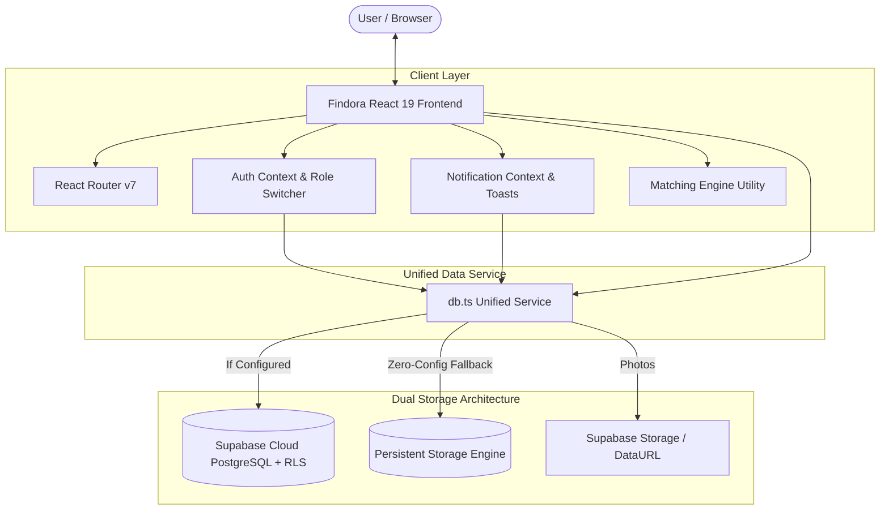

<div align="center">

# 🔍 Findora — Lost & Found Portal
### *"Lost something? Let's bring it back."*

[](https://findora-lost-and-found.netlify.app/)

[](https://react.dev/)
[](https://www.typescriptlang.org/)
[](https://vitejs.dev/)
[](https://tailwindcss.com/)
[](https://supabase.com/)
[](https://vitest.dev/)
[](LICENSE)

A modern, production-ready, full-stack Lost & Found web portal connecting students, staff, visitors, patients, and community members with their misplaced belongings through community-driven notices, smart algorithmic cross-referencing, and two-tier ownership verification.

🚀 **Live Portal**: [https://findora-lost-and-found.netlify.app/](https://findora-lost-and-found.netlify.app/)

[Live Demo](https://findora-lost-and-found.netlify.app/) • [Features](#-features) • [Architecture](#-architecture) • [Matching Engine](#-smart-matching-engine) • [Deployment Guide](#-where-to-deploy) • [Getting Started](#-getting-started) • [Database Setup](#-database--supabase-setup)

---

</div>

## 📌 Overview

**Findora** resolves the fragmentation and security vulnerabilities of traditional physical lost & found desks, bulletin boards, and social media posts. Designed for high-traffic environments—such as **universities, schools, hospitals, corporate campuses, shopping malls, libraries, and transit stations**—Findora empowers users to file reports while strictly safeguarding confidential personal information.

---

## ✨ Features

### 1. 🤖 Algorithmic Smart Matching Engine
- Automated cross-referencing between opposite report types (`lost` ↔ `found`).
- Transparent weighted compatibility scoring across 5 key dimensions:
  $$\text{Score} = (0.35 \times \text{Text}) + (0.25 \times \text{Category}) + (0.20 \times \text{Location}) + (0.10 \times \text{Date}) + (0.10 \times \text{Attributes})$$
- Automatically triggers upon report creation or updates, generating persistent match records and in-app notifications.

### 2. 🛡️ Secure Two-Tier Claim Workflow
- **Public Message**: General context of where the item was lost.
- **Confidential Verification Details**: Private serial numbers, unique engravings, lock screen wallpapers, or specific bag contents.
- Details remain encrypted/hidden from public listings and are accessible strictly to the finder and institutional administrators.
- Claim status pipeline: `pending` → `under_review` → `approved` → `completed` (or `rejected`).
- Automatically transitions item status to `reunited` upon confirmed return.

### 3. 🔎 Advanced Search & Multi-Filter Directory
- Full-text search across item titles, descriptions, brands, colors, and locations.
- Granular filtering:
  - **Report Type**: All, Lost, Found.
  - **9 Standard Categories**: Electronics, Documents & IDs, Bags & Wallets, Keys, Clothing & Footwear, Books & Stationery, Jewelry & Accessories, Medical & Health, Other.
  - **10 Facility Contexts**: University, Hospital, Corporate, Shopping Mall, Library, Transit Hub, Public Park, Airport, etc.
  - **Status**: Active, Reunited, All.
- URL-synchronized state for bookmarking and sharing search results.

### 4. 🔔 Persistent In-App Notifications
- Real-time notification badges for detected matches, submitted claims, and review updates.
- One-click deep links directly to the related report or claim view.
- Floating toast alert system for user feedback on all actions.

### 5. 📊 Multi-Role Dashboards & Admin Center
- **Personal Dashboard (`/dashboard`)**: Active lost & found tallies, match spotlights, and quick actions.
- **My Reports (`/my-reports`)**: Tabbed manager with status toggles (`reunited`), edits, and report withdrawal.
- **My Claims (`/my-claims`)**: Claim tracking with reviewer instructions and feedback.
- **Admin Center (`/admin`)**: Restricted moderation center with institutional analytics, claim moderation, listing deletion, and immutable audit logs (`activity_logs`).

### 6. ⚡ Dual Persistence Engine
- **Cloud PostgreSQL via Supabase**: Production migrations with Row Level Security (RLS) policies, foreign keys, trigram text search, and image storage bucket scripts.
- **Zero-Config Persistent Local Mode**: Works immediately out of the box with browser storage, pre-seeded realistic items, authentications, and photo conversion with zero external setup required!

---

## 🏛 Architecture



---

## 🧮 Smart Matching Engine

The matching engine in [`src/utils/matchingEngine.ts`](file:///c:/Users/LENOVO/OneDrive/Desktop/Findora/src/utils/matchingEngine.ts) evaluates compatibility using a transparent scoring formula:

| Signal | Weight | Description |
|---|:---:|---|
| **Title & Description Similarity** | **35%** | Tokenized Jaccard similarity and partial subword containment across title and body |
| **Category Compatibility** | **25%** | Exact match (1.0) or broad classification overlap (0.4) |
| **Location & Facility Context** | **20%** | Landmark token overlap + facility type match bonus (+0.35) |
| **Timeline Proximity** | **10%** | Same day (1.0), within 3 days (0.85), within 7 days (0.70), within 14 days (0.50) |
| **Color, Brand & Attributes** | **10%** | Match on brand name, primary color, and identifying traits |

Matches scoring **≥ 35%** are registered as potential matches, alerting both the item owner and the finder.

---

## 🚀 Where to Deploy

Findora is a Single Page Application (SPA) with a lightweight, optimized build (`dist/`). You can deploy it to any of the following platforms in minutes:

### Option 1: Netlify (Active Production Deployment)
🌐 **Live URL**: [https://findora-lost-and-found.netlify.app/](https://findora-lost-and-found.netlify.app/)

1. Log in to [Netlify](https://netlify.com) and select **"Add new site"** → **"Import an existing project"**.
2. Select your GitHub repository (`chandana-builds/findora-lost-and-found`).
3. Configure build settings:
   - **Build command**: `npm run build`
   - **Publish directory**: `dist`
4. Notice that Findora includes [`public/_redirects`](file:///c:/Users/LENOVO/OneDrive/Desktop/Findora/public/_redirects) (`/* /index.html 200`) so all client-side routes (`/browse`, `/items/:id`, etc.) resolve seamlessly without 404s.
5. Click **Deploy site**.

### Option 2: Vercel

### Option 3: Cloudflare Pages
1. In the Cloudflare Dashboard, go to **Workers & Pages** → **Create application** → **Pages** → **Connect to Git**.
2. Select `findora-lost-and-found`.
3. In build configuration:
   - **Framework preset**: `Vite`
   - **Build command**: `npm run build`
   - **Output directory**: `dist`
4. Click **Save and Deploy**.

### Option 4: GitHub Pages
1. In `vite.config.ts`, set `base: '/findora-lost-and-found/'`.
2. Run `npm run build`.
3. Deploy the `dist` directory using `gh-pages` or a GitHub Actions workflow.

---

## 🗄️ Database & Supabase Setup

Findora runs with full persistence out of the box. To connect your cloud PostgreSQL database:

1. Create a project at [supabase.com](https://supabase.com).
2. Navigate to **SQL Editor** in the Supabase Dashboard.
3. Paste and run the complete migration script:
   [`supabase/migrations/20261022000000_findora_schema.sql`](file:///c:/Users/LENOVO/OneDrive/Desktop/Findora/supabase/migrations/20261022000000_findora_schema.sql).
4. Create a `.env` file in the project root:
   ```env
   VITE_SUPABASE_URL=https://your-project-id.supabase.co
   VITE_SUPABASE_ANON_KEY=your-supabase-anon-key
   ```
5. Restart your dev server or trigger a new build. Findora will automatically connect to Supabase!

---

## 👥 Demo Test Personas

Use the **Switch Role / User** dropdown in the top bar to test different roles instantly:

| Persona | Role | Email | Scenario |
|---|---|---|---|
| **Alex Rivera** | User (Student) | `alex.rivera@campus.edu` | Has reported a lost MacBook Pro; has an active claim |
| **Dr. Sarah Chen** | User (Staff) | `sarah.chen@hospital.med` | Has registered a found laptop; reviews claims |
| **Findora Admin** | Admin (Security) | `admin@findora.org` | Full access to `/admin` moderation center & audit logs |

---

## 💻 Getting Started Locally

### Prerequisites
- Node.js (v18 or higher; v24 recommended)
- npm (v9 or higher)

### Installation & Run

```bash
# 1. Clone the repository
git clone https://github.com/chandana-builds/findora-lost-and-found.git
cd findora-lost-and-found

# 2. Install dependencies
npm install --legacy-peer-deps

# 3. Start local development server
npm run dev

# 4. Open in browser
# http://localhost:5173/
```

### Running Automated Tests

```bash
# Run Vitest test suite
npm test

# Run Vitest in watch mode
npm run test:watch
```

### Production Build

```bash
npm run build
```

---

## 📁 Repository Structure

```
findora-lost-and-found/
├── public/
│   ├── _redirects                     # SPA routing redirect rule for Netlify/Cloudflare
│   └── favicon.svg                    # Custom Findora brand SVG icon
├── src/
│   ├── __tests__/                     # Vitest automated test suites
│   │   ├── matching.test.ts           # 5 unit tests for matching algorithm
│   │   └── db.test.ts                 # 5 integration tests for db, claims & auth
│   ├── components/                    # Modular UI components
│   │   ├── Footer.tsx                 # Portal footer and legal references
│   │   ├── ItemCard.tsx               # Report card with badges, tags & photo
│   │   ├── Logo.tsx                   # Findora SVG magnifying glass + checkmark
│   │   ├── Navbar.tsx                 # Responsive header with role switcher
│   │   └── ToastContainer.tsx         # Notification toast alerts
│   ├── context/                       # React Context state providers
│   │   ├── AuthContext.tsx            # Session, authentication & demo switcher
│   │   └── NotificationContext.tsx    # Unread counter & toast dispatch
│   ├── lib/
│   │   └── supabase.ts                # Supabase client configuration
│   ├── pages/                         # Application route views
│   │   ├── AdminPage.tsx              # Moderation portal & audit logs
│   │   ├── BrowsePage.tsx             # Directory with search, filters & pagination
│   │   ├── ContactPage.tsx            # Help center & support contact
│   │   ├── DashboardPage.tsx          # Personal user overview
│   │   ├── ForgotPasswordPage.tsx     # Password recovery instructions
│   │   ├── HomePage.tsx               # Landing page with hero, stats & categories
│   │   ├── ItemDetailsPage.tsx        # Listing details, matches & claim modal
│   │   ├── LoginPage.tsx              # Sign-in form
│   │   ├── MyClaimsPage.tsx           # Claims tracker with reviewer feedback
│   │   ├── MyReportsPage.tsx          # Lost/found reports & status management
│   │   ├── NotificationsPage.tsx      # In-app alerts list
│   │   ├── PrivacyPage.tsx            # Privacy policy & data protection
│   │   ├── ProfilePage.tsx            # User profile and contact settings
│   │   ├── RegisterPage.tsx           # Account creation with role configuration
│   │   ├── ReportFoundPage.tsx        # Found item registration form
│   │   ├── ReportLostPage.tsx         # Lost item submission form
│   │   └── TermsPage.tsx              # Terms of use & community guidelines
│   ├── services/
│   │   ├── db.ts                      # Unified database & workflow service
│   │   └── mockSeedData.ts            # Realistic seed items and demonstration users
│   ├── types/
│   │   └── index.ts                   # Core TypeScript type definitions
│   ├── utils/
│   │   └── matchingEngine.ts          # Algorithmic cross-referencing engine
│   ├── App.tsx                        # Main routing & layout configuration
│   ├── index.css                      # Tailwind base and design utilities
│   └── main.tsx                       # React application entry point
├── supabase/
│   └── migrations/
│       └── 20261022000000_findora_schema.sql # Complete SQL schema, RLS & Storage
├── .env.example                       # Environment variables template
├── .gitignore                         # Git exclusion rules
├── package.json                       # Dependencies and run scripts
├── tailwind.config.js                 # Findora brand palette and typography
├── tsconfig.json                      # TypeScript configuration
└── vite.config.ts                     # Vite build configuration
```

---

## 📄 License

This project is licensed under the **MIT License**.
